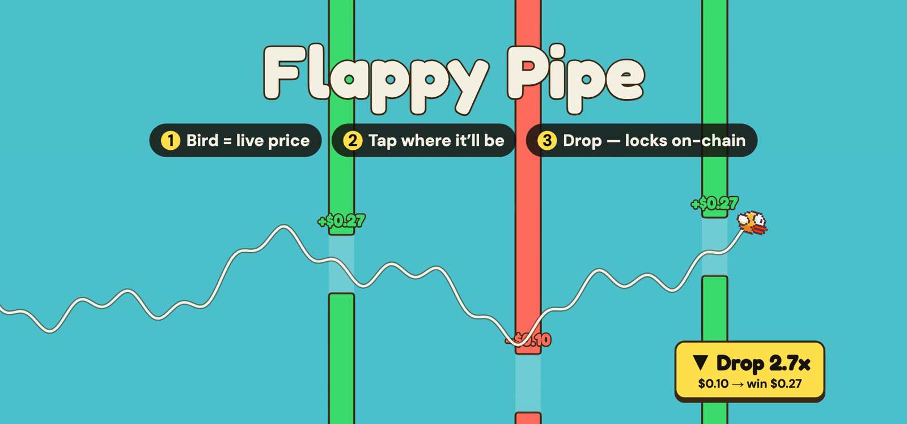

# Flappy Pipe



**Flappy Bird where the bird is a live on-chain price.** You bet testnet dollars on where it
will be when it reaches the next pipe. A NEAR contract reads the price, prices every pipe,
holds the money and settles every bet. There are no wallet popups while you play.

| | |
|---|---|
| **Play** | https://flappy-pipe.vercel.app (NEAR testnet) |
| **Video** | [`docs/flappy-pipe-pitch.mp4`](docs/flappy-pipe-pitch.mp4) (1:48 pitch + live demo, voiced, captioned) |
| **Contract** | [`riptide-6024.testnet`](https://testnet.nearblocks.io/address/riptide-6024.testnet) (Rust, near-sdk 5.30) |
| **Built at** | NEAR HACKATHON, Nov 2026 · tracks: Games, DeFi |

## The problem

Five-second "tap-trading" games are booming, but the house runs them on its own servers:
prices, payouts and outcomes are invisible, and you just trust them. On-chain versions fix
trust but make you sign a wallet popup for every move, which kills a reflex game. And a
candlestick chart scares off most people before their first trade.

## What Flappy Pipe does

- **The bird is a live price.** Its height is a [Rhea (Ref)](https://rhea.finance) testnet pool
  price, read on-chain every 1–3 s. There are three markets with one shared balance:
  **wNEAR/RFT** (pool 0), **wNEAR/ELIXIR** (pool 275) and **wNEAR/GOLD** (pool 274).
- **A pipe every 5 seconds.** Tap where you think the bird will be (or drag the gap; − / +
  set its size), then hit **▼ Drop**. The button rides under the pipe and says how long the
  pipe stays open.
- **Fair, on-chain multiplier.** `1 / P(price at the pipe inside your gap)`, from realized
  volatility, minus a 3% house edge, capped at 100x and locked on-chain when the bet lands.
  Narrow gaps, or gaps far from the bird, pay more.
- **Instant result, settled on-chain.** When the bird reaches your pipe the game shows it at
  once: "Through! +$0.38" or "Hit the pipe −$0.10". The contract's permissionless `settle`
  confirms it seconds later, using the same rule on the same samples.
- **Zero popups.** Guests get a funded testnet account in about 10 seconds. Wallet players
  approve one limited game key at sign-in; every Drop after that signs silently.
- **Multiplayer.** Create a tournament, share the link, and race friends on the same pipes. The
  contract pays the pot 50/30/20 at the bell.
- **Global leaderboard.** On-chain P&L, win rate and best multiplier for every player.
- **Wallet.** Deposit $1–$25, cash out at any time (guests can forward the payout to any
  account), and see your trade history.
- **Sound.** Flappy Bird effects and an original chiptune loop, with a mute toggle.

## Try it: do X → see Y

| Do | See |
|---|---|
| Open https://flappy-pipe.vercel.app | 3 onboarding cards, then the board in **Live** mode, with the bird flying the GOLD price |
| Tap **▶ Play** on the board | About 10 s later: "Funding your $10…", then a balance of $10.00. You now have a fresh testnet account and no wallet prompt appeared |
| Tap above or below the bird, then **▼ Drop 2.4x** | The balance drops by the stake at once, a wing sound plays, and the pipe turns solid with "2.4x · win $0.24 · 7s" counting down |
| Watch the bird reach that pipe | Inside the gap: green flash, chime, "Through! +$0.14", and the balance goes up. On the pipe: red pipe, shake, crash, "Hit the pipe −$0.10" |
| Switch **RFT / ELIXIR / GOLD** at the top | The board flips to that pool's live price, with the same balance |
| **Multiplayer** → Free · 3 min · 30 s → **Create** | A link `/?t=<id>&m=<market>` to copy. **Open lobby** shows a countdown banner; friends tap **Join** |
| **Leaderboard** | On-chain rank, P&L, win rate and best multiplier |
| **⇥ $balance** (top right) → **Cash out** | Your balance returns as testnet NEAR, a few seconds later |
| **Wallet → Connect NEAR wallet** | One approval adds a function-call key limited to the game's methods; a deposit is one more approval; Drops then sign silently |
| Pick **Demo** in the menu | A local simulator with a pretend $10. No chain, no wallet |

## Verify it yourself

```sh
bun install
bun run verify                    # one real-money round on testnet: deposit, place, poke, settle;
                                  # prints every tx as a nearblocks link and the result (Won/Lost)
bun apps/web/lib/board.check.ts   # the browser's copy of the settle rule agrees with the contract's
cd contracts/riptide && cargo test   # 31 contract tests (we run Rust in Docker: see "Run it")
```

Read-only checks against the live contract (any NEAR RPC; e.g. `near contract call-function
as-read-only riptide-6024.testnet <method> json-args '{}' network-config testnet now`):
`markets`, `board {"market":2}`, `vault`, `leaders`, `tourneys_live`,
`positions {"account_id":"<you>"}`.

## How it works

```
 Rhea pools (RFT · ELIXIR · GOLD)
        │  cross-contract get_pool (poke)
        ▼
 riptide-6024.testnet ── samples ring per market, gate prices, bets, vault,
        ▲                 stats/leaderboard, tournaments
        │ place / settle (session key)         views (board, positions, …)
 browser ─────────────────────────────────────────────────────────▲
        ▲
 engine (Bun): poke all markets every 2 s · settle every 2 s · settle_tourney at the bell
               · swap bot on the pools · guest faucet. Every job is a permissionless call.
```

- **Oracle.** `poke(market)` → `get_pool` on Rhea → `on_pool` (`#[private]`,
  `#[callback_result]`) stores a sample (at most one per 800 ms). As each sample lands, the
  contract prices every window end it crossed on the straight line from the previous sample
  and stores it as that window's **gate** (last 1024 windows per market).
- **Settle rule.** A bet wins iff `gate ∈ [band_lo·tick, (band_hi+1)·tick)`. With no gate price
  (samples more than 10 s apart) the stake is refunded. The browser draws the bird on exactly
  those lines between exactly those samples (4 s behind chain time) and decides each pipe with
  the same rule, so what you see is what settles. The chain's verdict wins any disagreement.
- **Pricing.** `quote = (1 − edge) / P(gate inside gap)`, with σ from realized variance over the
  last 64 samples, time measured from the last sample, and an integer-only normal-CDF table
  (`contracts/riptide/src/pricer.rs`, `phi.rs`). Quotes under 1.05x are rejected; `min_quote_bps`
  guards against slippage.
- **Money.** `deposit` (payable) credits mUSD ($0.001 units; $10 = 1 testnet NEAR). `place` moves
  the stake to the house vault and adds the payout to `open_liability`. Bets are rejected above
  $1 or if open liability would exceed 20% of the vault. `withdraw` needs 1 yocto and restores
  the balance if the transfer fails.
- **No popups.** Wallet sign-in adds an app-held function-call key limited to game methods
  (`docs/SIGNING.md`). Guests get an engine-sponsored sub-account whose key lives only in their
  browser.
- **Tournaments.** These are sessions ≥ 2 with their own 10,000-point stacks. `create_tourney`,
  `join_tourney` (before the start, entry paid from your balance) and
  `place_chips(id, …)` (only pipes inside the tournament). `settle_tourney` is
  permissionless after the bell: 50/30/20 by points, ties split, fewer than 2 players refunded.
  The vault is never touched.
- **Leaderboard.** `leaders()` returns the top 20 by cash P&L (trades plus prizes), kept sorted at
  settle time with bounded gas.

Full interface: [`docs/IMPLEMENTATION.md`](docs/IMPLEMENTATION.md). Decisions and history:
[`docs/HANDOFF.md`](docs/HANDOFF.md), [`docs/CHECKLIST.md`](docs/CHECKLIST.md).

## Why NEAR

- **Cross-contract calls** let the game contract read the AMM's reserves itself. No price
  signer, no off-chain oracle service.
- **Function-call access keys** make "one approval, then zero popups" possible without
  custody: the key can only call game methods, with a gas allowance, and can't move funds.
- **Sub-accounts** let the engine hand a guest a real funded account in one transaction.
- **Cheap, fast finality** makes a 5-second betting loop with per-bet transactions practical.

## Run it

```sh
bun install
bun run engine                               # :8787 — keys from ~/.near-credentials/testnet/<id>.json,
                                             # or ENGINE_KEY / BOT_KEY env vars when hosted
cd apps/web && cp .env.example .env.local    # NEXT_PUBLIC_ENGINE_URL=http://localhost:8787
bunx next dev -p 3001                        # open http://localhost:3001
```

- Engine flags: `ALWAYS_ON=1` never idles (otherwise it slows to 60 s pokes, bot paused, when no page is
  open); `NPCS=1` adds free-chip NPC traders; `GUEST_COOLDOWN_MS` sets the faucet limit per IP.
- Contract: `cd contracts/riptide && cargo near build non-reproducible-wasm`. This repo built it in
  a `rust:1-bookworm` Docker container with cargo-near 0.23.
- Hosting: the web app is static-friendly Next.js (Vercel). The engine is one Bun process on
  any always-on machine; during judging it runs on the team's machine behind a Cloudflare tunnel.

## Repository map

```
contracts/riptide/   Rust contract: lib.rs (markets, gates, bets, vault, stats, tournaments, 31 tests),
                     pricer.rs (integer pricing), phi.rs (generated normal-CDF table)
apps/web/            Next.js game: app/page.tsx (canvas board, aiming, Drop, results),
                     app/{multiplayer,leaderboard,wallet}, lib/near.ts (RPC, sessions, signing),
                     lib/board.ts (geometry, local quote, settle rule), lib/sound.ts, skins/flappy.ts
apps/engine/         Bun engine (index.ts) and the end-to-end check (verify.ts)
video/               Remotion pitch: animated SVG scenes + real recordings, Soniox voiceover
scripts/             gen-phi-table.ts (pricer table), gen-music.ts (original chiptune)
docs/                interface spec, signing design, handoff, checklist, pitch deck (pitch.html), video
```

## Testnet deployment

| Account | Role |
|---|---|
| `riptide-6024.testnet` | game contract + owner |
| `riptide-6024-engine.testnet` | poke, settle, settle_tourney, guest sponsor |
| `riptide-6024-bot.testnet` | swap bot on the three pools |

Key transactions (`https://testnet.nearblocks.io/txns/<hash>`):

- v4 markets upgrade + `migrate`: `CD9y3jUMWnprc8GQYGXnmXs1f2Pyo8bGf7uxs5eMrBZo`
- v3 gate rule, leaderboard and tournaments + `migrate`: `7ooWKBU5unLVhQRbWdXGfKcaMKUR8dSY1n7yTpcJ8GY5`
- v2 cash mode: `3nCKwMqpgSwXkpND3FwzopNoXcYg6sS81Vj5rRshYaqy` · first deploy: `CDAenqY93n8xMKK2vPXRHoAppGZarYB5PUYcx5835XE1`
- Vault funded with 10 NEAR: `33CpABtumh4GGe7BMuhuDhXSQRxdJzek6m4YK1Zd6Jkn`
- Wallet path, tested end to end through near-connect: add game key
  `Cvr9sv1j6Ar8QyBZAVdfd6nuPa8MWvBH63F9fQSUQjYW`, $1 deposit
  `G8Fvoc7DtisKM2znepqwsUX6JmUyqWT4D61HnvXXnvw`, silent Drop
  `23E1dGtbmgxq4MTrCzn2fXZo9CMdZPiFd9zbfUdLaoB1`
- Two-player tournament #2, settled at the bell by the engine (a tie: $2 pot split $1/$1)

## Risks and limits (read before trusting it with anything)

- **The house moves the price.** Testnet pools are otherwise idle, so our own bot's swaps are
  what move them. The operator, or anyone with enough liquidity, could push the price out of a
  player's gap. Mainnet needs deep pools or a TWAP / multi-source oracle.
- **Front-running.** A bet is priced from the last sample (up to 5 s old). The $1 stake cap, the
  100x cap and the 20% exposure cap bound the vault's loss; they don't remove the edge.
- **Owner powers.** `set_config` and `add_market` are owner-only (1 yocto). The unit rate is
  locked after the first deposit. There is no timelock.
- **Storage** is paid by the contract (positions are pruned per account). **Guest faucet:** 1.25
  testnet NEAR per IP per 10 min, a testnet convenience.
- **Liveness.** Samples need pokes. Gaps over 10 s leave pipes unpriced and those bets refund:
  nothing lost, nothing won.
- **NEAR Intents** is not used. The project is testnet-only and Intents/1Click are mainnet services.
  Cross-chain deposits through Intents are the first mainnet step.

## Hackathon disclosures

- Built during NEAR HACKATHON (Nov 2026); all commits are in the window. No pre-existing product
  or chain port (Q-001, Q-002, Q-004).
- Libraries (Q-005): near-sdk (Rust), uint, near-api-js, @hot-labs/near-connect, Next.js, React,
  TanStack Query, Bun, Remotion, Playwright (recording and tests only).
- Written with AI coding assistants (Claude Code). A human directed the product decisions,
  logged in `docs/HANDOFF.md` §7.

## Credits

- Sprites and sound effects: [samuelcust/flappy-bird-assets](https://github.com/samuelcust/flappy-bird-assets)
  (MIT, `apps/web/public/flappy/LICENSE-assets.txt`).
- Canvas loop ideas (scrolling background/ground, 4-frame wing flap):
  [omariosouto/flappy-bird-devsoutinho](https://github.com/omariosouto/flappy-bird-devsoutinho) (MIT),
  credited in `apps/web/skins/flappy.ts`.
- Music: original chiptune loop from `scripts/gen-music.ts`. Video UI sounds: remotion.media.
  Voiceover: Soniox TTS.

MIT licensed. See [LICENSE](LICENSE).
